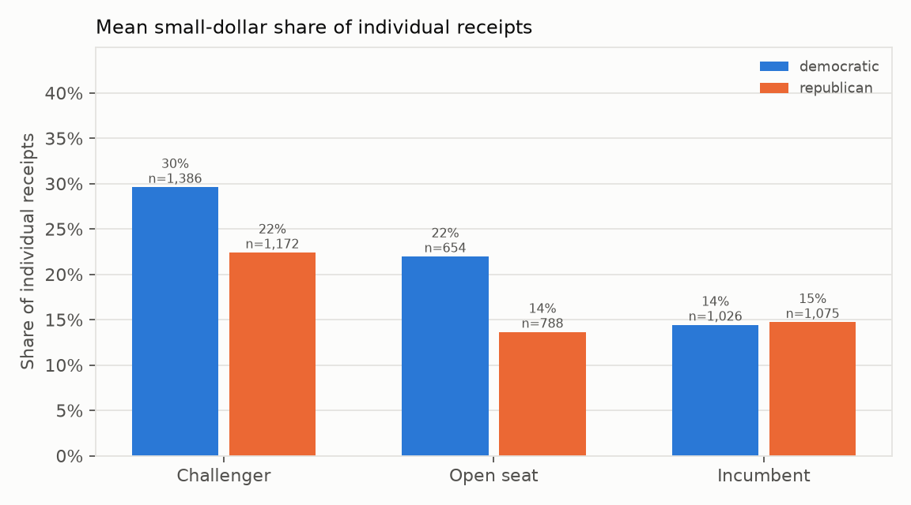
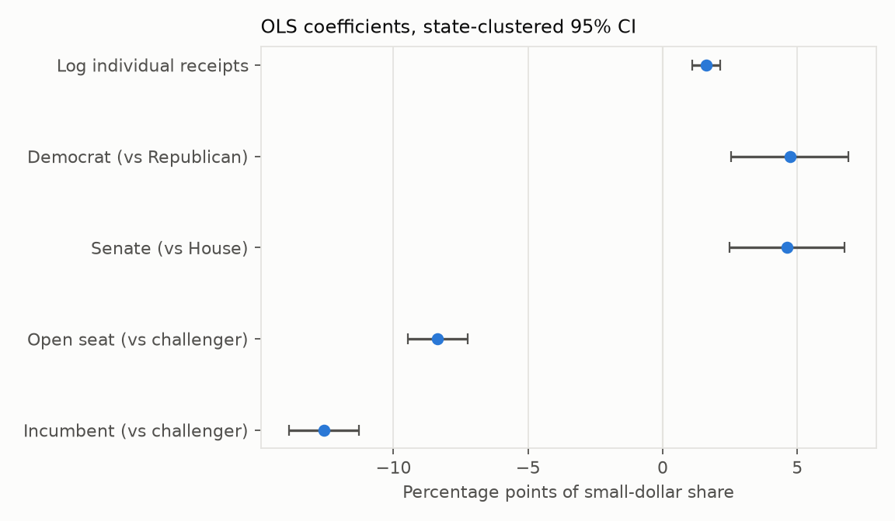
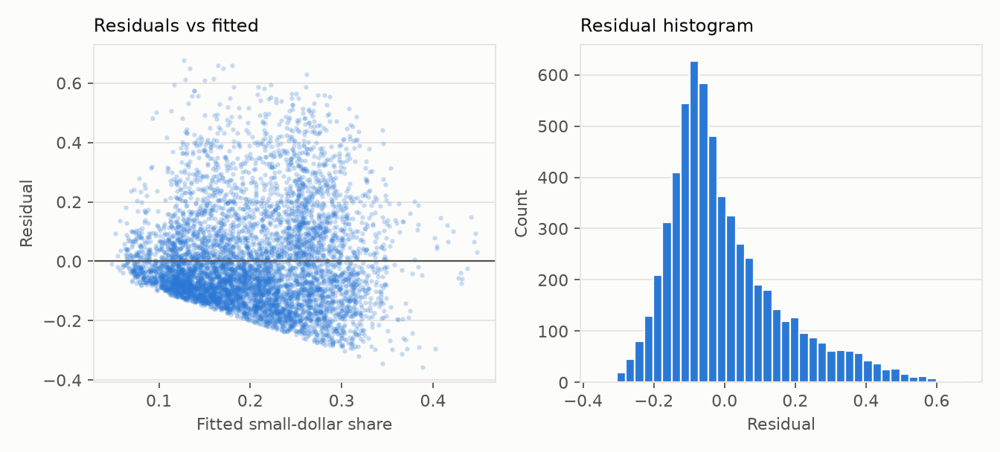
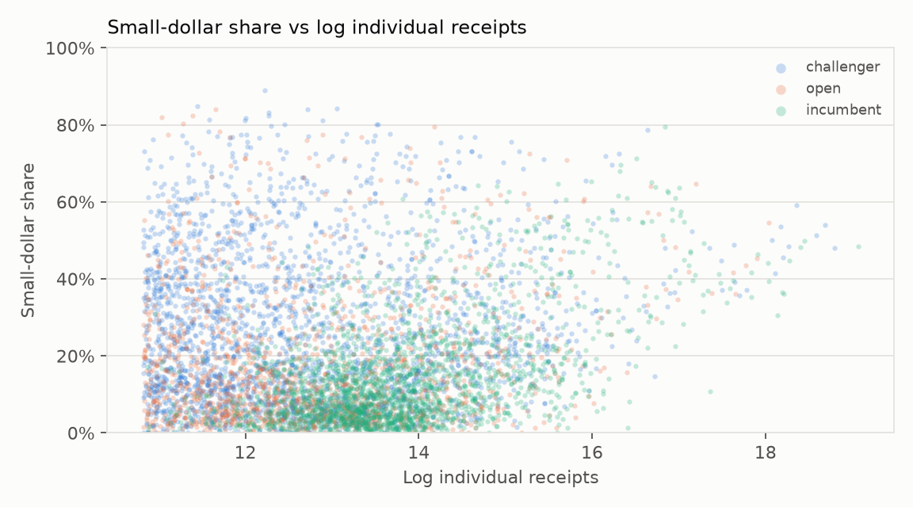

# What predicts a federal candidate's small-dollar share?

*OLS and fractional logit on FEC candidate summaries, cycles 2016-2024. Generated 2026-11-10 by `analysis/regression.py`. Every number below comes from that run (see `analysis/output/tables/`). Public data only.*

## Question

Among major-party House and Senate candidates who raised a meaningful amount from individuals, what predicts the share of that individual money that is unitemized (donors who gave $200 or less in the cycle)? The predictors are incumbency, open seat, office (Senate vs House), party, and log individual receipts, with cycle fixed effects.

The example of pooling FEC itemized rows with the seven state bulk files cannot support this question. FEC unitemized totals live on the candidate summary (and in `fec_totals` for profiled candidates), not in `contributions`. State itemization thresholds are not $200, Texas files have no party, Wisconsin and North Carolina have no office, and no state connector yet has an incumbent/challenger flag (it is on the roadmap). So this analysis uses the public FEC candidate-summary file, which is the same Form 3 rollup the pipeline already stores per profiled candidate, but for every candidate in the cycle.

## Data

- Source: FEC candidate summary CSV, [file description](https://www.fec.gov/campaign-finance-data/candidate-summary-file-description/).
- Cycles in the main sample: 2016, 2018, 2020, 2022, 2024. 2012 and 2014 are downloaded and used only as a robustness check. 2026 is excluded because the cycle is not over.
- Outcome: `Individual_Unitemized_Contribution / Individual_Contribution`. Unitemized means the donor did not exceed $200 to that campaign in the cycle, so the committee does not itemize the gift. This is a reporting threshold, not a survey of donor intent.
- Incumbency: FEC `Cand_Incumbent_Challenger_Open_Seat` (incumbent / challenger / open).
- Companion outcome in robustness: PAC share of total contributions (`Other_Committee_Contribution / Total_Contribution`).

## Sample

Main sample: **6,101 candidate-cycles** after filters. Keep House and Senate only (presidential fundraising is a different market), Democrats and Republicans, known incumbency, individual receipts of at least $50,000 and total receipts of at least $50,000. The money floor drops long-shot committees whose share is 0% or 100% because of a handful of gifts.

Mean small-dollar share: **20.2%**. Mean PAC share of contributions: **19.3%**. By incumbency: challengers 26.3%, open seats 17.4%, incumbents 14.6%. By party: Democrats 22.9%, Republicans 17.4%.

2 shares were outside [0, 1] before clipping (floating-point or refund noise). They were clipped; the count is reported so the clip cannot hide a data problem.

## Method

1. **OLS.** The share is a number between 0 and 1. OLS coefficients are percentage-point differences holding the other regressors fixed. Omitted groups: challenger, House, Republican, and 2016 (cycle dummies absorb a common year shock).
2. **Standard errors.** HC3 allows the residual variance to differ across campaigns (heteroskedasticity). State-clustered SEs also allow campaigns in the same state to share unobserved donor networks and party infrastructure. The main table reports clustered SEs; HC3 is next to them.
3. **Fractional logit.** Because the outcome is a share, a binomial GLM (Papke and Wooldridge 1996) keeps fitted values in [0, 1]. Coefficients are not percentage points, so the table shows average partial effects, which are.
4. **Diagnostics.** Summary means, a correlation matrix, VIFs on the design matrix, and residual plots.
5. **Robustness.** House only; $100k individual floor; drop log size; state fixed effects; cluster by candidate; drop heavy self-funders; PAC share as the outcome; add 2012-2014.

This is an association, not a causal design. Incumbency is not random, and campaigns choose how they raise money.

## Results



*Figure 1. Mean unitemized share of individual receipts. Table: `analysis/output/tables/group_means.csv`.*



*Figure 2. Main OLS coefficients in percentage points, 95% CI clustered by state. Table: `analysis/output/tables/regression_main.csv`.*

| Variable | OLS, clustered by state | OLS, HC3 | Fractional logit APE |
|---|---|---|---|
| Incumbent (vs challenger) | -12.6 (0.7) | -12.6 (0.5) | -11.5 |
| Open seat (vs challenger) | -8.4 (0.6) | -8.4 (0.6) | -7.2 |
| Senate (vs House) | 4.6 (1.1) | 4.6 (0.8) | 4.5 |
| Democrat (vs Republican) | 4.7 (1.1) | 4.7 (0.4) | 4.8 |
| Log individual receipts | 1.6 (0.3) | 1.6 (0.2) | 1.5 |

N = 6,101. OLS R-squared = 0.153. Cells are percentage points of the 0-1 share, with standard errors in parentheses. Cycle dummies are in the table file and omitted here.

### Plain English

- Holding office, party, cycle, and log individual receipts fixed, incumbents' small-dollar share is **-12.6 percentage points lower** than challengers' (clustered SE 0.7, p < 0.001).
- Open-seat candidates are **-8.4 percentage points lower** than challengers (SE 0.6, p < 0.001).
- Senate candidates are **4.6 percentage points higher** than House candidates (SE 1.1, p < 0.001).
- Democrats are **4.7 percentage points higher** than Republicans (SE 1.1, p < 0.001).
- Doubling individual receipts is associated with a **1.1 percentage-point increase** in the small-dollar share (log coefficient 1.6, SE 0.3, p < 0.001). The partial size effect is small next to incumbency; once incumbency is held fixed, larger individual programs are not more itemized.

The fractional-logit average partial effects have the same signs. That is the check that OLS is not being driven by the linear model predicting shares outside [0, 1].

## Diagnostics



*Figure 3. OLS residuals vs fitted values, and the residual histogram. Shares pile up near 0, so residuals are not textbook-normal. That is why we also fit the fractional logit and why SEs are robust.*



*Figure 4. Small-dollar share against log individual receipts. Incumbents cluster toward lower shares at a given size; the regression is asking whether that gap remains after party, office, and cycle.*

The largest VIF among the main regressors (not cycle dummies) is **1.41** (incumbent). Values under 5 are the usual rule of thumb that collinearity is not driving the SEs. The full VIF table is `analysis/output/tables/vif.csv`. Pairwise correlations are in `analysis/output/tables/correlation.csv`.

## Robustness

Each row refits the same idea on a different sample, SE, or outcome. The incumbent and Democrat coefficients are the ones to watch.

| Specification | N | Incumbent | Democrat |
|---|---|---|---|
| main_ols_cluster_state | 6,101 | -12.6 (0.7) | 4.7 (1.1) |
| ols_hc3 | 6,101 | -12.6 (0.5) | 4.7 (0.4) |
| ols_cluster_candidate | 6,101 | -12.6 (0.6) | 4.7 (0.5) |
| house_only | 5,444 | -12.6 (0.7) | 4.6 (1.1) |
| min_individual_100k | 5,226 | -12.4 (0.7) | 2.9 (1.1) |
| no_log_individual | 6,101 | -10.7 (0.6) | 5.1 (1.1) |
| state_fe_hc3 | 6,101 | -12.2 (0.5) | 5.0 (0.5) |
| pac_share_dv | 6,101 | 41.1 (0.9) | -0.3 (0.8) |
| drop_heavy_self_fund | 5,944 | -12.9 (0.7) | 4.7 (1.1) |

The incumbency gap is negative in every specification that uses small-dollar share as the outcome.

Switching the outcome to PAC share flips the sign: incumbents take a larger share of their contributions from other committees. That is a different mix, not a contradiction.

Adding 2012 and 2014 (N = 8,168) leaves the incumbent coefficient at -11.7 (SE 0.6).

## Limitations

- **Correlation is not causation.** Incumbents differ from challengers in name recognition, committee assignments, and who chooses to run. The coefficient is the remaining gap after the controls in the table, not the effect of making someone an incumbent.
- **Selection.** Candidates below the $50,000 individual floor are out. That drops many uncompetitive challengers. Raising the floor to $100,000 is in the robustness table.
- **Omitted variables.** There is no district partisanship, no Cook PVI, and no general-election vote share. The FEC all-candidates file stopped carrying vote share after 2006, and this summary file never had it. Competitiveness is therefore not in the model. Ideology, candidate quality, and presidential-year coattails are also missing.
- **Simultaneity.** Small-dollar share is a strategy (email, ActBlue, WinRed) and a result of being the kind of candidate those platforms promote. Log receipts is partly a consequence of the same things as the outcome; the specification without it is in the robustness table.
- **The $200 line is legal, not behavioral.** A $201 donor is fully itemized. Two $100 gifts in two cycles look like small-dollar; $200 in one cycle does not.
- **Joint fundraising transfers.** The small-dollar share uses individual contributions as the denominator, so transfers from authorized committees are not in the outcome. They still affect who shows up in the sample via total receipts.
- **Repeated candidates.** Some people appear in several cycles. Main SEs cluster by state; a candidate-level cluster is in robustness.
- **State disclosure data are out of this regression on purpose.** They cannot be stacked with FEC unitemized totals without pretending the itemization rules match. They remain the right source for state-office questions this repo already answers with `compare_elections`.

## Reproduce

```bash
python3 -m venv .venv && source .venv/bin/activate
pip install -e '.[analysis]'
python analysis/regression.py
```

Files land in `analysis/output/` (tables, figures, `manifest.json`) and `docs/regression-writeup.md` plus `docs/regression-writeup.pdf`. Re-running on the same CSVs should match. The CSVs themselves are cached under `data/raw/fec/` (gitignored) and hashed in the manifest.

Offline tests use a tiny fixture CSV and do not hit the network: `pytest tests/test_regression.py`.
