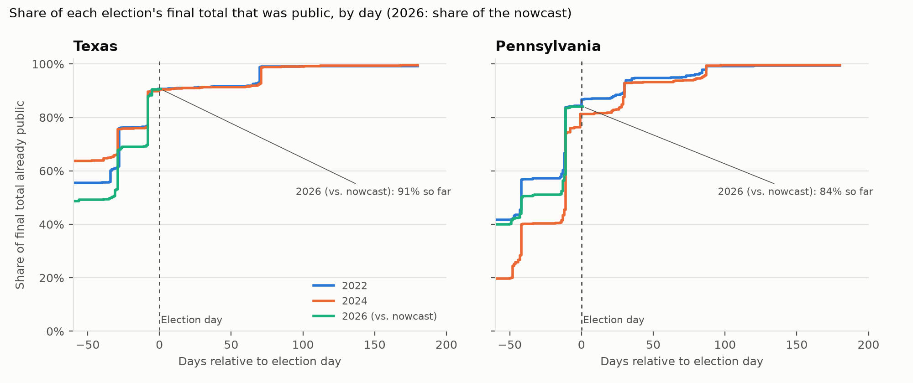
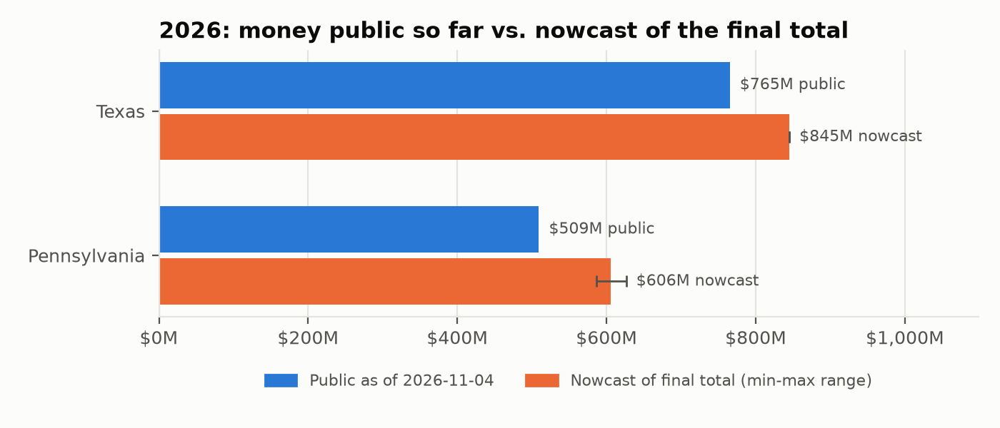
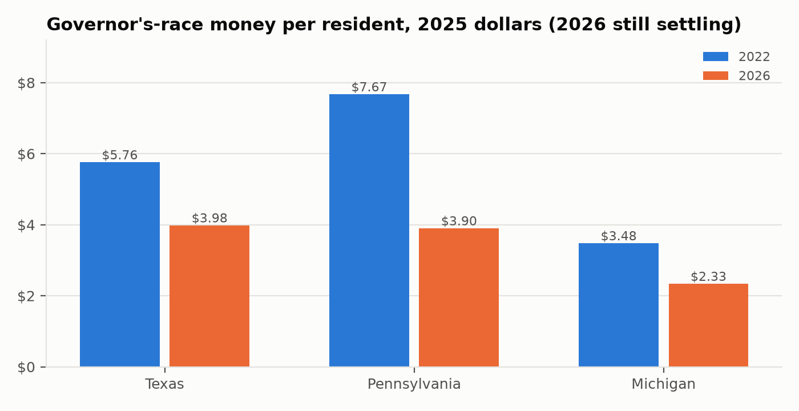

# How much do early filings understate final campaign totals?

*Revision analysis of state campaign-finance totals, Texas, Pennsylvania, 2022-2026. Generated 2026-11-04 by `reports/revisions/build.py`; every number below is computed by that script (see `tables/`).*

## Summary

- **Texas:** on election day, 90.5% to 90.6% of the eventual total had been reported (2022 and 2024); by 90 days after, 99.0% to 99.1%. A nowcast built from those patterns puts 2026 at $844.7M (range $844.4M to $845.0M), versus $765.2M public today. Leave-one-out backtest error at election day: 0.1%.
- **Pennsylvania:** on election day, 81.3% to 86.8% of the eventual total had been reported (2022 and 2024); by 90 days after, 99.2% to 99.4%. A nowcast built from those patterns puts 2026 at $605.9M (range $586.7M to $626.3M), versus $509.2M public today. Leave-one-out backtest error at election day: 6.5%.
- **Texas governor:** $5.76 per resident in 2022 vs $3.98 in 2026 (inflation-adjusted; 2026 still settling).
- **Pennsylvania governor:** $7.67 per resident in 2022 vs $3.90 in 2026 (inflation-adjusted; 2026 still settling).
- **Michigan governor:** $3.48 per resident in 2022 vs $2.33 in 2026 (inflation-adjusted; 2026 still settling).

## Data

- Itemized contributions from state disclosure systems: Texas Ethics Commission (full database), Pennsylvania Department of State (yearly full exports). Loans, public funds, and other non-contribution receipts are excluded.
- Filing dates: Texas report received date; Pennsylvania report submitted date. Each contribution is dated by when its report became public.
- BEA reference data: SAINC1 state personal income and population; PCE price index (DPCERG). File vintages are listed in `manifest.json`.
- Election windows: contributions dated after the previous November election day through this one.

## Method

1. **Vintage reconstruction.** For each election window, the total *as it would have been known* on day D is the sum of contributions whose report was filed by D. This mirrors comparing BEA's advance estimate with later vintages.
2. **Revision measures.** For mature windows (180+ days after the election), the share of the final total known at each lag and the revision from each vintage to the final.
3. **Nowcast.** For 2026, the total public today divided by the mean share known at the same lag in past elections of the same kind (even-year generals). The range uses the reference elections' extremes; with two references it is a min-max band, not a confidence interval.
4. **Backtest.** Each mature election is predicted from the others at every lag (leave-one-out); errors are reported separately for even- and odd-year elections because their reporting patterns differ.
5. **Real dollars.** Nominal totals deflated by the PCE price index to the latest full year; per-resident figures use BEA state population.

## Results



*Figure 1. Share of each election's final total that was public, by day relative to election day. 2026 is plotted against its nowcast, since its final total is not known yet. Table: `tables/shares.csv`.*

| State | Election | Election day | +30 days | +90 days | Final |
|---|---|---|---|---|---|
| Texas | 2022 | 90.6% | 91.4% | 99.1% | $697.5M |
| Texas | 2024 | 90.5% | 91.3% | 99.0% | $571.1M |
| Pennsylvania | 2022 | 86.8% | 92.9% | 99.2% | $524.9M |
| Pennsylvania | 2024 | 81.3% | 92.9% | 99.4% | $460.4M |



*Figure 2. 2026 total public today (blue) and the nowcast of the final total (orange) with the min-max range from reference elections. Table: `tables/nowcast.csv`.*

| State | Elections | Election day | +30 days | +90 days |
|---|---|---|---|---|
| Texas | even-years | 0.1% | 0.1% | 0.1% |
| Pennsylvania | even-years | 6.5% | 0.0% | 0.1% |

*Table: mean absolute backtest error of the nowcast by days after election (`tables/backtest.csv`).*



*Figure 3. Money raised by governor's-race committees per resident, inflation-adjusted. Includes each committee's whole election window; candidate-linked committees (e.g. Texas specific-purpose committees) are counted under the candidate. Table: `tables/governor.csv`.*

## Limitations

- Two reference elections per state is a small sample; the 2026 ranges are indicative.
- Vintages use report filing dates; amended reports carry their amendment date and appear as late revisions.
- Itemized contributions only; unitemized small-dollar money is reported differently by each state.
- Office is each committee's latest office on file.
- 2026 is still settling, and BEA personal income for 2026 is not yet published (the latest year is used and flagged in the tables).
- Georgia is excluded from the nowcast: no mature election of the same kind (even/odd year) with a share at this lag; refusing to extrapolate from a different kind of election.

## Reproducibility

```bash
.venv/bin/cm sync TX && .venv/bin/cm sync PA --years 2021 2022 2023 2024 2025 2026
.venv/bin/cm sync BEA
.venv/bin/python reports/revisions/build.py
```

Data vintages, rules applied, and the code version are in `manifest.json`. Rules are defined in `src/candidate_modeling/scope.py`.
